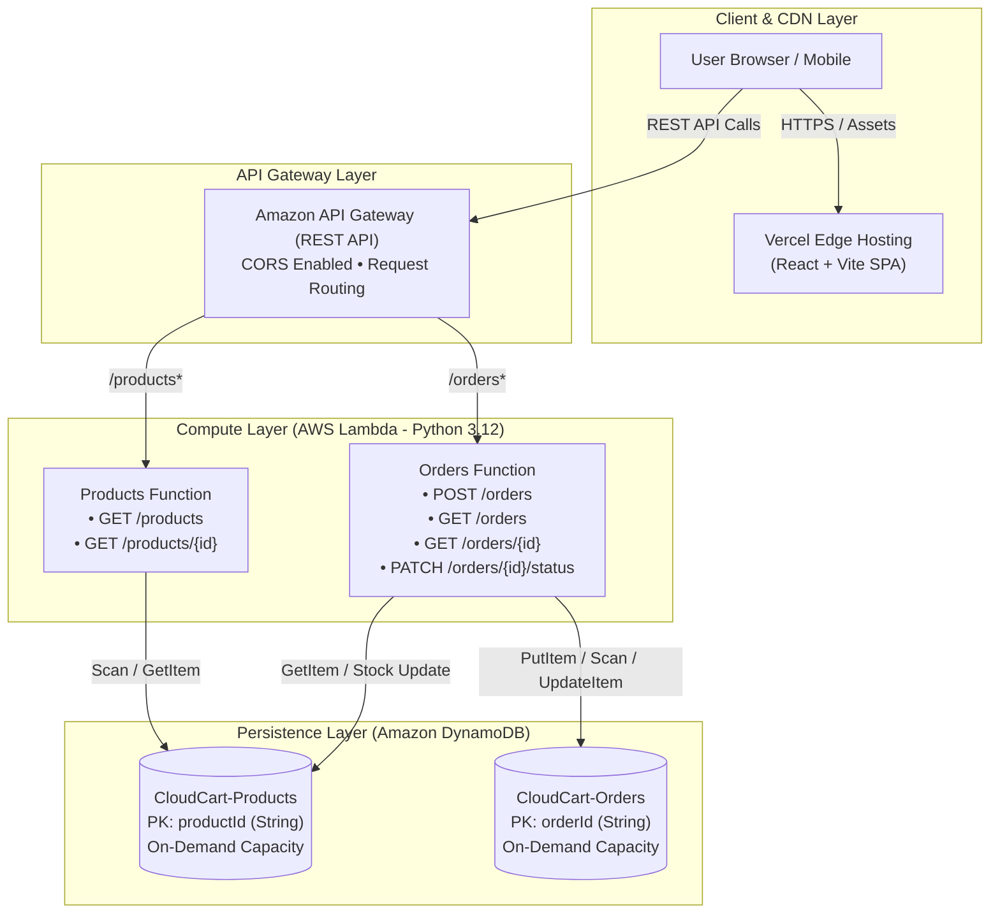

# CloudCart – Serverless E-Commerce & Order Management Platform

CloudCart is a production-style, serverless e-commerce and order lifecycle management MVP. It demonstrates modern full-stack cloud engineering using **React + Vite**, **AWS Lambda (Python 3.12)**, **Amazon API Gateway**, and **Amazon DynamoDB**, configured for deployment to AWS and Vercel.

---

## Architecture Overview



---

## AWS Services Used

| AWS Service | Role in CloudCart | Why It Was Chosen |
|---|---|---|
| **Amazon API Gateway** | Managed REST API Entrypoint | Provides URL routing, automatic HTTPS termination, CORS preflight handling, rate limiting, and seamless Lambda proxy integration. |
| **AWS Lambda** (Python 3.12) | Serverless Compute Engine | Completely stateless compute that scales from zero to peak traffic without provisioning or managing servers. Handlers execute on-demand with pay-per-use billing. |
| **Amazon DynamoDB** | NoSQL Document Persistence | Fast, single-digit millisecond latency at any scale. On-demand billing (`PAY_PER_REQUEST`) eliminates idle capacity costs. Schemas are partitioned cleanly (`productId` and `orderId`). |
| **AWS SAM** (Serverless Application Model) | Infrastructure as Code (IaC) | Declarative CloudFormation-based template defining all API Gateway routes, Lambda IAM execution roles, and DynamoDB tables in code. |
| **Vercel** | Frontend Hosting & Edge CDN | Provides atomic builds, global CDN edge caching, and automated HTTPS for the Vite React single-page application. |

---

## REST API Specification

All endpoints return JSON responses with standard CORS headers (`Access-Control-Allow-Origin: *`).

### Products API

| Method | Endpoint | Description | Status Code |
|---|---|---|---|
| `GET` | `/products` | Lists products. Supports optional `?category=` and `?search=` filters. | `200 OK` |
| `GET` | `/products/{id}` | Fetches a single product by its unique `productId`. | `200 OK` / `404 Not Found` |

### Orders API

| Method | Endpoint | Description | Status Code |
|---|---|---|---|
| `POST` | `/orders` | Validates stock, calculates authoritative totals & tax, and creates order with initial `PENDING` status. | `201 Created` / `400 Bad Request` |
| `GET` | `/orders` | Lists all customer orders, sorted newest first. | `200 OK` |
| `GET` | `/orders/{id}` | Fetches order details by `orderId`. | `200 OK` / `404 Not Found` |
| `PATCH` | `/orders/{id}/status` | Updates order lifecycle status (`PENDING` &rarr; `PROCESSING` &rarr; `SHIPPED` &rarr; `DELIVERED` / `CANCELLED`). | `200 OK` / `400 Bad Request` |

### Sample Request Payloads

#### `POST /orders`
```json
{
  "customer": {
    "name": "Jane Doe",
    "email": "jane.doe@example.com",
    "address": "123 Serverless Way",
    "city": "Seattle",
    "postalCode": "98101",
    "country": "US"
  },
  "items": [
    {
      "productId": "prod-001",
      "quantity": 1
    },
    {
      "productId": "prod-002",
      "quantity": 2
    }
  ]
}
```

#### `PATCH /orders/{id}/status`
```json
{
  "status": "PROCESSING"
}
```

---

## Project Structure

```
cloudcart/
├── README.md                      # Comprehensive documentation & architecture guide
├── backend/
│   ├── handlers/
│   │   ├── products_handler.py    # Lambda proxy entrypoint for /products
│   │   └── orders_handler.py      # Lambda proxy entrypoint for /orders
│   ├── services/
│   │   ├── product_service.py     # Product listing, search, filtering business logic
│   │   └── order_service.py       # Stock validation, tax/total calculation, status logic
│   ├── db/
│   │   ├── client.py              # DynamoDB client (boto3 + zero-dependency local simulator)
│   │   └── seed_data.py           # DynamoDB product catalog seeding script
│   ├── utils/
│   │   ├── response.py            # API Gateway proxy response with CORS & Decimal JSON encoder
│   │   └── validator.py           # Pure-Python input validation for orders and path params
│   ├── tests/
│   │   ├── test_products.py       # Unit tests for product endpoints
│   │   ├── test_orders.py         # Unit tests for order creation & status transitions
│   │   └── test_local_server.py   # Full end-to-end integration test
│   ├── data/
│   │   └── sample_products.json   # Seed catalog of production electronics
│   ├── local_server.py            # Local HTTP server bridging requests to Lambda handlers
│   ├── template.yaml              # AWS SAM Infrastructure-as-Code specification
│   └── requirements.txt           # Python dependencies (boto3, pytest)
└── frontend/
    ├── package.json
    ├── vite.config.js             # Vite config with fast refresh & proxy
    ├── index.html
    ├── vercel.json                # Single-page app routing rules for Vercel
    ├── public/
    │   └── favicon.svg
    └── src/
        ├── App.jsx                # Root shell, routing, toasts, modals
        ├── main.jsx               # React 18 root
        ├── index.css              # Custom modern responsive design system
        ├── api/
        │   └── client.js          # REST API client with error handling
        ├── context/
        │   └── CartContext.jsx    # Cart state & localStorage persistence
        ├── components/
        │   ├── Navbar.jsx         # Sticky navigation header with cart badge
        │   ├── ProductCard.jsx    # Responsive product card with stock badges
        │   ├── ProductModal.jsx   # Product detail popup with quantity selector
        │   ├── CartDrawer.jsx     # Slide-over cart with live tax & subtotal
        │   ├── CheckoutModal.jsx  # Order placement form with validation
        │   ├── OrderStatusBadge.jsx # Status color badges
        │   └── EmptyState.jsx     # Reusable empty state placeholder
        └── pages/
            ├── ProductsPage.jsx   # Product catalog with search and filters
            ├── OrdersPage.jsx     # Order history with real-time PATCH status updater
            └── OrderDetailPage.jsx # Individual order drill-down & DynamoDB JSON inspector
```

---

## Local Setup & Development

CloudCart is designed so that anyone can run and test both the backend and frontend locally without needing an AWS account or Docker containers.

### 1. Backend Setup & Run

Open a terminal in the project directory:

```bash
# Optional: create a Python virtual environment
python3 -m venv venv
source venv/bin/activate

# Seed initial product data
python3 backend/db/seed_data.py

# Start the local API Gateway + Lambda simulator server (runs on port 5001)
python3 backend/local_server.py
```

The local server will start at `http://localhost:5001`, mapping routes directly to the Lambda handler functions. (Note: Port 5001 is used by default to prevent port conflicts with macOS AirPlay Receiver on port 5000).

### 2. Run Backend Tests

CloudCart includes comprehensive unit and integration tests using Python's standard `unittest`:

```bash
python3 -m unittest discover -s backend/tests -v
```

All 16 tests verify:
- CORS options preflight
- Product listing, search, and category filtering
- Stock availability and deduction
- Authoritative server-side price calculation and 8% tax
- Order validation (missing fields, invalid emails, empty items)
- Order status lifecycle transitions (`PENDING` &rarr; `PROCESSING` &rarr; `SHIPPED` &rarr; `DELIVERED` / `CANCELLED`)

### 3. Frontend Setup & Run

In a second terminal window:

```bash
cd frontend

# Install dependencies
npm install

# Start Vite development server (runs on port 3000)
npm run dev
```

Open your browser at `http://localhost:3000`.

---

## Deployment Steps

### 1. Deploying the Backend to AWS (AWS SAM)

Prerequisites:
- [AWS CLI](https://aws.amazon.com/cli/) configured with valid AWS credentials (`aws configure`)
- [AWS SAM CLI](https://docs.aws.amazon.com/serverless-application-model/latest/developerguide/install-sam-cli.html)

Steps:

```bash
cd backend

# Build Lambda artifacts
sam build

# Deploy via guided CloudFormation wizard
sam deploy --guided
```

SAM will:
1. Create the `CloudCart-Products` and `CloudCart-Orders` DynamoDB tables in on-demand mode.
2. Package and deploy `ProductsFunction` and `OrdersFunction` with least-privilege IAM DynamoDBCrud policies.
3. Configure the Amazon API Gateway REST API with CORS headers.
4. Output the live `CloudCartApiEndpoint` (e.g. `https://xyz123.execute-api.us-east-1.amazonaws.com/Prod`).

#### Seed Production DynamoDB Table:
```bash
AWS_REGION=us-east-1 PRODUCTS_TABLE=CloudCart-Products python3 backend/db/seed_data.py
```

### 2. Deploying the Frontend to Vercel

Prerequisites:
- [Vercel CLI](https://vercel.com/docs/cli) installed or GitHub integration enabled.

Steps:

1. In `frontend/.env.production`, set your API Gateway stage URL:
   ```env
   VITE_API_BASE_URL=https://xyz123.execute-api.us-east-1.amazonaws.com/Prod
   ```

2. Deploy using the Vercel CLI:
   ```bash
   cd frontend
   vercel --prod
   ```

Or simply push your repository to GitHub and connect it in the Vercel Dashboard with root directory set to `frontend`. The included `vercel.json` ensures client-side routing works smoothly across page reloads.

---

## Key Interview Talking Points

If asked to explain this architecture in an engineering interview:

1. **Why Serverless for E-Commerce?**
   - E-commerce traffic is bursty (flash sales, marketing campaigns). Serverless scales down to \$0 when idle and autoscales instantly to thousands of requests during traffic spikes without provisioning EC2 or managing Kubernetes clusters.

2. **How is Backend Statelessness Maintained?**
   - No session memory is kept in the Lambda instances. The shopping cart state is kept client-side and submitted atomically with the order. All authoritative state (catalog prices, inventory stock, order status) resides in DynamoDB.

3. **How Does Price Tampering Prevention Work?**
   - Clients only submit `{ productId, quantity }`. The server never trusts client-side prices. During `POST /orders`, `OrderService` reads the true price directly from the DynamoDB products table, computes item subtotals, applies sales tax, and writes the authoritative order total.

4. **Handling DynamoDB Numbers & JSON Serialization:**
   - AWS SDK (`boto3`) returns numerical DynamoDB types as Python `Decimal` instances, which `json.dumps()` rejects by default. CloudCart uses a custom `DecimalEncoder` in `response.py` that cleanly formats Decimals into standard JSON numbers.

5. **Local Testability Without Cloud Emulation Overhead:**
   - The repository implements a clean repository pattern: `db/client.py` uses boto3 against real DynamoDB in AWS Lambda, but seamlessly falls back to a zero-dependency local simulator in development mode. Developers can run the entire system and all tests in milliseconds with zero setup friction.
